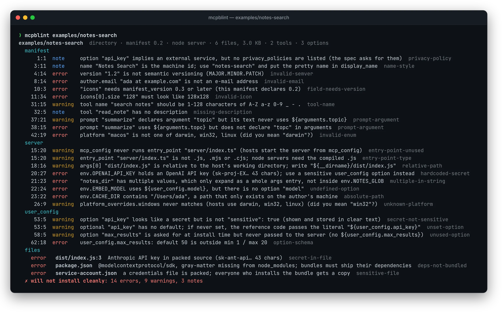

<p align="center">
  
</p>

<h3 align="center">Lint MCP Bundles (.mcpb, formerly .dxt) before anyone installs them: the manifest, how it wires user_config, and every file you are about to ship.</h3>

<p align="center">
  <a href="https://github.com/celaldrg/mcpblint/actions/workflows/ci.yml"></a>
  <a href="https://github.com/celaldrg/mcpblint/releases"></a>
  <a href="LICENSE"></a>
  
  
</p>

## Why

[MCP Bundles](https://github.com/modelcontextprotocol/mcpb) are how local MCP servers get to people who will never edit a JSON config: one `.mcpb` file (a zip with a `manifest.json`), double-click, install. Claude Desktop installs them today, and the format is now maintained under the Model Context Protocol project. The catch is that a bundle is a promise about someone else's machine. The manifest is a strict schema that changes between versions, `mcp_config` is a template the host fills in from `user_config`, and everything in the folder gets copied to every user.

The mistakes are quiet. `${user_config.model}` with no `model` option reaches your server as that literal text. A `multiple: true` folder option inside an env string is never expanded. An API key left in `env` or in a compiled file ships to everyone. `"platforms": ["macos"]` or `platform_overrides.windows` never match. `icons` on a 0.2 manifest gets the whole file rejected. `dist/index.js` without `${__dirname}` depends on the host's working directory. A zip of the *folder* instead of its contents has no manifest at the root.

`mcpblint` reads a packed `.mcpb`, a source folder (seen exactly the way `mcpb pack` would pack it, default excludes and `.mcpbignore` included) or a bare `manifest.json`, and reports each problem with a line and column.

- **Manifest, per version**: the strict 0.1 to 0.4 schemas (unknown keys with typo suggestions, required fields, types, fields that only exist in later versions, `uv` needing 0.4), semver, URLs, e-mail, icons, localization, compatibility platforms and ranges.
- **`mcp_config` against `user_config`**: undefined and unused options, optional options with no default, `multiple` options that cannot expand, unknown `${...}` variables, platform overrides that never match, commands that do not fit `server.type`, `npx`/`uvx`/`docker` launchers, relative paths, absolute paths from your machine.
- **Secrets**: literal keys in `env`/`args`, secret-looking options without `sensitive: true`, sensitive options passed as arguments (visible in `ps`), API keys and private keys inside packed source files, `.env` files, key stores and credentials files.
- **Files**: entry point exists, matches the server type and is executable, a `.exe` exists if you claim Windows, `${__dirname}/...` paths exist, Node `dependencies` are really in `node_modules` (and devDependencies are not), Python deps have a `server/lib`, `uv` layout rules, junk like `__pycache__`.
- Zero dependencies, one static binary, fast enough for a pre-commit hook. `--json` for CI, `--strict` to fail on warnings, `--ignore` to switch rules off.

<p align="center">
  
  <br><sub>Real output: <code>mcpblint examples/notes-search</code>, a bundle folder with the mistakes above. 14 errors, 9 warnings, 3 notes.</sub>
</p>

## Install

Download a binary from the [v0.1.0 release](https://github.com/celaldrg/mcpblint/releases/tag/v0.1.0) (Linux, macOS, Windows; amd64 and arm64), or with Go:

```sh
go install github.com/celaldrg/mcpblint@v0.1.0
```

Or from source:

```sh
git clone https://github.com/celaldrg/mcpblint && cd mcpblint
go build -o mcpblint .
```

## Usage

```text
mcpblint [options] <bundle.mcpb | dir | manifest.json | ->...

  --json            machine-readable output
  --strict          exit 1 on warnings too
  --quiet           only show errors
  --ignore <rules>  comma-separated rule ids to skip
  --rules           list every rule and exit
  --no-color        disable colors (also NO_COLOR=1)
```

With no arguments the current directory is checked. Exit codes: `0` clean (warnings allowed unless `--strict`), `1` problems found, `2` usage or read error.

```sh
mcpblint                          # the bundle folder you are in, as mcpb pack would pack it
mcpblint dist/my-server.mcpb      # what you are about to upload
mcpblint --json *.mcpb > lint.json
cat manifest.json | mcpblint -    # manifest only, no file checks
```

In CI, after `mcpb pack`:

```yaml
- uses: actions/setup-go@v5
  with: { go-version: "1.22.x" }
- run: go install github.com/celaldrg/mcpblint@v0.1.0
- run: mcpblint --strict dist/*.mcpb
```

## Example

<p align="center">
  
  <br><sub>Recorded with <a href="https://github.com/charmbracelet/vhs">vhs</a>: <code>mcpblint examples/unit-converter</code>, then <code>mcpblint --quiet examples/weather-py.mcpb</code>.</sub>
</p>

[`examples/unit-converter`](examples/unit-converter) is a small, working, dependency-free Node bundle:

```text
$ mcpblint examples/unit-converter
examples/unit-converter  directory · manifest 0.3 · node server · 4 files, 4.8 KB · 2 tools · 1 option
  ✓ ready to ship: 0 errors, 0 warnings, 0 notes
```

[`examples/weather-py.mcpb`](examples/weather-py.mcpb) is a packed Python bundle with the classic packaging mistakes: zipped with its folder, a `.env` inside, no vendored dependencies, a token passed on the command line:

```text
$ mcpblint examples/weather-py.mcpb
examples/weather-py.mcpb  archive · manifest 0.1 · python server · 5 files, 783 B · 1 tool · 1 option
  manifest
      2:3  warning  dxt_version is deprecated; rename it to manifest_version  deprecated-dxt-version
  server
    12:58  warning  sensitive option "token" is passed in args[2], where any local user can read it in the process list; pass it through env  secret-in-args
    13:30  error    env.PYTHONPATH points at "server/lib", which is not in the bundle  missing-file
  files
    error   weather-py/manifest.json  manifest.json is inside "weather-py/"; hosts read it from the archive root (zip the folder's contents)  manifest-not-at-root
    error   .env  an environment file is packed; everyone who installs the bundle gets a copy  sensitive-file
    error   requirements.txt  Python deps declared, but no server/lib or server/venv is packed (pip install -t server/lib, or use "uv")  deps-not-bundled
    note    server/__pycache__/main.cpython-312.pyc  Python bytecode caches packed (1 file); add them to .mcpbignore  junk-file
  ✗ will not install cleanly: 4 errors, 2 warnings, 1 note
```

### On real bundles

Run against the example bundles in the [mcpb repository](https://github.com/modelcontextprotocol/mcpb/tree/main/examples) (main branch, November 2026), `mcpblint` reports that `chrome-applescript` and `file-system-node` declare `manifest_version: "0.1"` but use `privacy_policies` (added in 0.2) and the non-schema keys `scripts` and `id`. `mcpb validate` 2.1.2 rejects both manifests for the same reasons. The source folders of `hello-world-node`, `file-system-node` and `calculator-rust` are also flagged until you run `npm install` or `cargo build`, because their dependencies or binary are not there yet. After `npm install --omit=dev` and `mcpb pack`, the `hello-world-node` archive (1,118 files, 6.1 MB) is checked in about 25 ms and has no errors.

## Rules

| Rule | Severity | What it catches |
| --- | --- | --- |
| `invalid-json` | error | manifest.json is not valid JSON |
| `duplicate-key` | warning | a key appears twice in one object; only the last one counts |
| `missing-version` | error | neither manifest_version nor dxt_version is set |
| `unknown-version` | error | manifest_version is not a published spec version (0.1 to 0.4) |
| `deprecated-dxt-version` | warning | dxt_version is deprecated; use manifest_version |
| `version-conflict` | error | dxt_version and manifest_version disagree |
| `missing-field` | error | a required field is missing or empty |
| `wrong-type` | error | a field has the wrong JSON type |
| `unknown-field` | error | a field the spec version does not define (strict schema); typos get a suggestion |
| `field-needs-version` | error | a field or value that only exists in a later manifest_version |
| `invalid-semver` | error | version is not semantic versioning |
| `invalid-url` | error | homepage, documentation, support, repository, author.url or privacy_policies is not a URL |
| `invalid-email` | error | author.email is not an e-mail address |
| `name-style` | note | name is meant to be machine-readable; display_name is for humans |
| `invalid-enum` | error | server.type, compatibility.platforms or user_config type has a value the spec does not allow |
| `invalid-range` | warning | a compatibility version constraint is not a semver range |
| `runtime-mismatch` | warning | compatibility.runtimes does not match server.type |
| `unlisted-client` | warning | a compatibility key other than claude_desktop, platforms, runtimes (rejected by mcpb validate) |
| `invalid-icon` | error | icon or icons[] is absolute, uses ${__dirname}, is missing, not a PNG, or has a bad size |
| `remote-icon` | warning | icon is a URL; Claude Desktop only shows icons packed in the bundle |
| `invalid-localization` | error | localization.resources lacks ${locale} or default_locale is not BCP 47 |
| `duplicate-tool` | error | two tools or prompts share a name |
| `tool-name` | warning | tool name has characters outside A-Z a-z 0-9 _ - . or is longer than 128 |
| `missing-description` | note | a tool or prompt has no description for the install dialog |
| `prompt-argument` | error | prompt text uses ${arguments.x} that is not declared, or declares an argument it never uses |
| `no-tools` | note | no tools declared and tools_generated is not true |
| `privacy-policy` | note | the bundle takes an API key but lists no privacy_policies |
| `mcp-config` | error | mcp_config is missing (only uv servers may omit it) or has no command |
| `unknown-variable` | error | ${...} that hosts do not substitute |
| `system-dir-variable` | warning | ${HOME}, ${DESKTOP}, ${DOCUMENTS} or ${DOWNLOADS} in mcp_config: documented, but rejected by mcpb validate |
| `undefined-option` | error | ${user_config.x} where x is not defined in user_config |
| `unused-option` | warning | a user_config option that mcp_config never passes to the server |
| `unset-option` | warning | an optional option with no default: if never set, the reference implementation passes the literal ${user_config.x} |
| `multiple-in-string` | error | a multiple: true option inside a longer string or env value cannot be expanded |
| `hardcoded-secret` | error | a literal API key or token in mcp_config env or args |
| `secret-not-sensitive` | warning | an option that carries a secret is not marked sensitive: true |
| `secret-in-args` | warning | a sensitive option passed as a command-line argument (visible in the process list) |
| `absolute-path` | error | an absolute path from the author's machine (/Users/..., /home/..., C:\Users\...) |
| `relative-path` | warning | a bundle path in args without ${__dirname}; it resolves against the host's working directory |
| `entry-point-unused` | warning | mcp_config never runs server.entry_point |
| `command-mismatch` | warning | mcp_config.command does not fit server.type |
| `not-self-contained` | warning | npx, uvx, pipx, bunx or docker: the server is downloaded at run time instead of shipped |
| `unknown-platform` | warning | a platform_overrides key that never matches (use darwin, win32, linux) |
| `option-schema` | error | a user_config option has a bad default, min/max, or a flag that does not apply to its type |
| `missing-file` | error | entry_point, an icon, a screenshot or a ${__dirname} path is not in the bundle |
| `entry-point-type` | warning | entry_point extension does not match server.type |
| `not-executable` | error | a binary entry_point without the executable bit |
| `windows-binary` | warning | a binary server that claims win32 but ships no .exe |
| `deps-not-bundled` | error | package.json dependencies missing from node_modules, or Python deps with no lib/venv |
| `dev-deps-bundled` | warning | devDependencies are packed into node_modules |
| `uv-layout` | error | uv server without pyproject.toml, or with server/lib or server/venv |
| `manifest-not-at-root` | error | the archive has manifest.json inside a folder instead of at its root |
| `sensitive-file` | error | a .env file, private key, keystore or credentials file is packed |
| `secret-in-file` | error | a packed source file contains an API key, token or private key |
| `junk-file` | note | __pycache__, .pyc, .DS_Store, .git or test caches are packed |
| `large-bundle` | note | the bundle or one file in it is unusually large |

## How it relates to `mcpb validate`

The official CLI's `mcpb validate` checks a manifest against the schema and also checks the icon, the entry point and `${...}` variable names, and warns about sensitive file names. Use it. `mcpblint` is a second opinion with a different focus:

- it reads **packed `.mcpb` archives** as well as folders, so you can check what you actually ship (including archives built by other tools);
- it reports **every problem at once with line and column**, instead of stopping at the first schema failure;
- it cross-checks **`mcp_config` against `user_config`** (undefined, unused, unset and `multiple` options, secrets in args) and looks for **secrets in packed file contents**, dependency layout and platform mismatches, none of which a schema can express;
- it is one static binary with JSON output, for CI and editors.

Where the two disagree, the spec text and the reference code in `modelcontextprotocol/mcpb` are the reference: for example, `${HOME}` in `mcp_config` is documented in the manifest spec but rejected by `mcpb validate`, so `mcpblint` warns instead of failing.

## Credits

The rules follow the [MCPB manifest spec](https://github.com/modelcontextprotocol/mcpb/blob/main/MANIFEST.md), the versioned schemas in `src/schemas`, and the variable substitution and packing behaviour in the reference implementation (MIT, Anthropic and MCPB contributors). No code is copied from it; `mcpblint` is written from scratch in Go with only the standard library.

## License

MIT, see [LICENSE](LICENSE).
